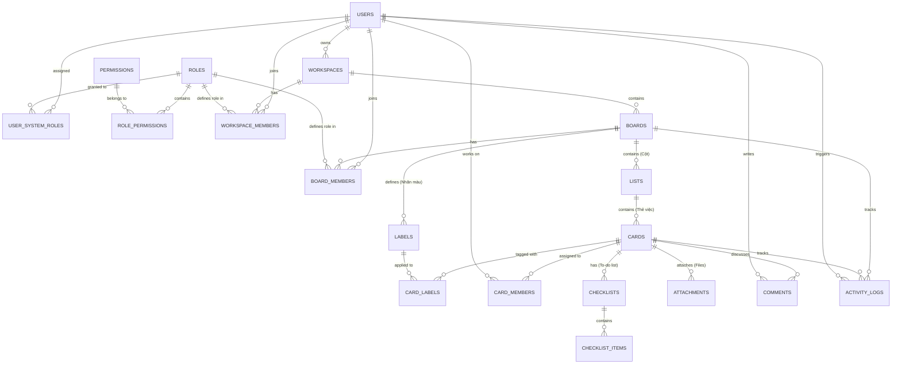

# INSTRUCTIONS: Xây dựng Hệ thống Quản lý Công việc Chuẩn Trello (Trello Clone Enterprise)
> **Dự án:** Trello-like Work & Task Management Platform  
> **Backend:** Java 21 + Spring Boot 4 (Spring Security, Spring Data JPA, PostgreSQL, WebSocket STOMP)  
> **Frontend:** Next.js (App Router) / React + Tailwind CSS + shadcn/ui + Drag & Drop (`@hello-pangea/dnd` hoặc `@dnd-kit`)  
> **Kiến trúc:** Dynamic Lists/Columns, Cards, Checklists, Labels, Attachments, Members, Realtime Sync

---

## 📑 Mục lục
1. [Phân tích Bản chất Nghiệp vụ Trello vs Task Manager truyền thống](#1-phân-tích-bản-chất-nghiệp-vụ-trello-vs-task-manager-truyền-thống)
2. [Thiết kế Cơ sở Dữ liệu Chi tiết (Database Schema Chuẩn Trello)](#2-thiết-kế-cơ-sở-dữ-liệu-chi-tiết-database-schema-chuẩn-trello)
3. [Giải thuật Sắp xếp & Kéo thả (Positioning Algorithm)](#3-giải-thuật-sắp-xếp--kéo-thả-positioning-algorithm)
4. [Lộ trình Triển khai Chi tiết Step-by-Step](#4-lộ-trình-triển-khai-chi-tiết-step-by-step)
   - [Giai đoạn 1: Chuẩn bị CSDL & Entity Mapping](#giai-đoạn-1-chuẩn-bị-csdl--entity-mapping)
   - [Giai đoạn 2: Workspace & Board Architecture](#giai-đoạn-2-workspace--board-architecture)
   - [Giai đoạn 3: Dynamic Lists & Cards System](#giai-đoạn-3-dynamic-lists--cards-system)
   - [Giai đoạn 4: Chi tiết Thẻ (Checklists, Labels, Attachments, Members, Due Date)](#giai-đoạn-4-chi-tiết-thẻ-checklists-labels-attachments-members-due-date)
   - [Giai đoạn 5: Frontend Kanban Board & Drag-and-Drop UX](#giai-đoạn-5-frontend-kanban-board--drag-and-drop-ux)
   - [Giai đoạn 6: Real-time Multi-user Collaboration (WebSocket) & Activity Feed](#giai-đoạn-6-real-time-multi-user-collaboration-websocket--activity-feed)
5. [Quy chuẩn API Contract](#5-quy-chuẩn-api-contract)

---

## 1. Phân tích Bản chất Nghiệp vụ Trello vs Task Manager truyền thống

Trong Task Manager truyền thống, trạng thái thường bị fix cứng (ví dụ: `TODO`, `IN_PROGRESS`, `DONE`). **Trello linh hoạt hơn rất nhiều:**
* **Cấu trúc phân cấp 5 tầng:** `Workspace` ➔ `Board` ➔ `List` (Cột động do người dùng tự tạo/đổi tên/di chuyển) ➔ `Card` (Thẻ việc) ➔ `Items` (Checklist con, Labels, Attachments).
* **Kéo thả 2 chiều (2D Drag & Drop):** 
  - Kéo thả **List** sang trái/phải trên Board.
  - Kéo thả **Card** trong cùng một List (thay đổi thứ tự trên/dưới).
  - Kéo thả **Card** từ List này sang List khác (đổi vị trí và danh mục cùng lúc).
* **Card Details toàn diện:** 
  - **Checklists**: Nhiều checklist trên 1 card, thanh tiến độ % hoàn thành tự động.
  - **Labels**: Gắn nhiều nhãn màu (Xanh, Đỏ, Vàng...) có thể đặt tên nhãn.
  - **Members Assignment**: Gắn nhiều thành viên vào cùng một card.
  - **Attachments**: Tải file, ảnh cover cho card.
  - **Due Date & Reminder**: Hạn chót kèm trạng thái đánh dấu hoàn thành (`is_completed`).
  - **Activity Feed**: Lịch sử chi tiết (vd: *"An đã chuyển card này từ Đang làm sang Hoàn thành"*).

---

## 2. Thiết kế Cơ sở Dữ liệu Chi tiết (Database Schema Chuẩn Trello)

### 2.1. Sơ đồ Quan hệ Thực thể (Mermaid Entity-Relationship Diagram)



### 2.2. Chi tiết Cấu trúc Từng Bảng (Data Dictionary)

#### 🏢 Nhóm 1: Quản trị Workspace & Người dùng & Hệ thống RBAC Linh hoạt
| Bảng | Cột (Column) | Kiểu dữ liệu | Ràng buộc | Ý nghĩa / Giải thích |
| :--- | :--- | :--- | :--- | :--- |
| **`users`** | `id` | BIGSERIAL | PK | Mã định danh người dùng |
| | `email` | VARCHAR(150) | UNIQUE, NOT NULL | Email đăng nhập |
| | `password` | VARCHAR(255) | NOT NULL | Mật khẩu mã hóa BCrypt |
| | `full_name` | VARCHAR(100) | NOT NULL | Họ và tên hiển thị |
| | `avatar_url`| VARCHAR(255) | NULL | Đường dẫn ảnh đại diện |
| | `status` | VARCHAR(20) | NOT NULL, DEFAULT 'ACTIVE' | Trạng thái: `ACTIVE`, `LOCKED`, `DELETED` |
| | `created_at`| TIMESTAMP | NOT NULL | Thời điểm tạo tài khoản |
| **`roles`** | `id` | BIGSERIAL | PK | Bảng vai trò linh hoạt (System, Workspace, Board) |
| | `name` | VARCHAR(50) | UNIQUE, NOT NULL | Tên vai trò (vd: `ROLE_SYSTEM_ADMIN`, `WORKSPACE_ADMIN`, `BOARD_EDITOR`, `BOARD_VIEWER`) |
| | `description`| VARCHAR(255) | NULL | Mô tả vai trò |
| | `scope` | VARCHAR(20) | NOT NULL | Phạm vi áp dụng: `SYSTEM`, `WORKSPACE`, `BOARD` |
| **`permissions`** | `id` | BIGSERIAL | PK | Bảng quyền hạn chi tiết (Granular Privileges) |
| | `code` | VARCHAR(50) | UNIQUE, NOT NULL | Mã quyền (vd: `BOARD:CREATE`, `BOARD:DELETE`, `CARD:MOVE`, `CARD:DELETE`, `USER:BAN`) |
| | `description`| VARCHAR(255) | NULL | Ý nghĩa quyền hạn |
| **`role_permissions`**| `role_id` | BIGINT | FK -> `roles.id` | Vai trò nào |
| | `permission_id`| BIGINT | FK -> `permissions.id`| Có quyền gì (Bảng liên kết N - N giữa Role & Permission) |
| **`user_system_roles`**| `user_id` | BIGINT | FK -> `users.id` | Người dùng nào |
| | `role_id` | BIGINT | FK -> `roles.id` | Giữ vai trò hệ thống nào |
| **`workspaces`** | `id` | BIGSERIAL | PK | Không gian làm việc (Team/Công ty) |
| | `name` | VARCHAR(120) | NOT NULL | Tên workspace (vd: "Phòng Công Nghệ") |
| | `slug` | VARCHAR(120) | UNIQUE, NOT NULL | URL thân thiện (vd: `phong-cong-nghe`) |
| | `description` | TEXT | NULL | Giới thiệu ngắn về workspace |
| | `owner_id` | BIGINT | FK -> `users.id` | Người sở hữu Workspace |
| **`workspace_members`** | `id` | BIGSERIAL | PK | Phân quyền RBAC trong Workspace |
| | `workspace_id`| BIGINT | FK -> `workspaces.id` | Thuộc workspace nào |
| | `user_id` | BIGINT | FK -> `users.id` | Thành viên nào |
| | `role_id` | BIGINT | FK -> `roles.id` | Giữ vai trò gì trong Workspace (Scope = WORKSPACE) |

---

#### 📋 Nhóm 2: Bảng Kanban, Cột (Lists) & Thẻ (Cards)
| Bảng | Cột (Column) | Kiểu dữ liệu | Ràng buộc | Ý nghĩa / Giải thích |
| :--- | :--- | :--- | :--- | :--- |
| **`boards`** | `id` | BIGSERIAL | PK | Mã định danh Bảng Trello |
| | `workspace_id`| BIGINT | FK -> `workspaces.id` | Thuộc Workspace nào |
| | `title` | VARCHAR(150) | NOT NULL | Tên bảng (vd: "Sprint 1 - Phát triển MVP") |
| | `background_url` | VARCHAR(255) | NULL | Màu HEX (#0079bf) hoặc link ảnh bìa |
| | `visibility`| VARCHAR(20) | NOT NULL | `PRIVATE`, `WORKSPACE`, hoặc `PUBLIC` |
| | `is_starred`| BOOLEAN | DEFAULT FALSE | Đánh dấu sao yêu thích lên đầu thanh bên |
| **`board_members`** | `id` | BIGSERIAL | PK | Thành viên tham gia Board |
| | `board_id` | BIGINT | FK -> `boards.id` | Board được truy cập |
| | `user_id` | BIGINT | FK -> `users.id` | Thành viên |
| | `role_id` | BIGINT | FK -> `roles.id` | Vai trò trong Board (Scope = BOARD: Admin, Editor, Viewer) |
| **`lists`** | `id` | BIGSERIAL | PK | Cột trên Board (Do user tự do tạo) |
| | `board_id` | BIGINT | FK -> `boards.id` | Thuộc Board nào |
| | `title` | VARCHAR(150) | NOT NULL | Tên cột (vd: "Cần làm", "Đang test", "Xong") |
| | `position` | DOUBLE PRECISION | NOT NULL | Vị trí thứ tự cột từ trái sang phải |
| | `is_archived`| BOOLEAN | DEFAULT FALSE | Trạng thái lưu trữ/ẩn cột |
| **`cards`** | `id` | BIGSERIAL | PK | Thẻ công việc (Card) |
| | `list_id` | BIGINT | FK -> `lists.id` | Thẻ đang nằm ở cột nào |
| | `title` | VARCHAR(255) | NOT NULL | Tiêu đề thẻ công việc |
| | `description`| TEXT | NULL | Mô tả chi tiết (hỗ trợ Markdown) |
| | `position` | DOUBLE PRECISION | NOT NULL | Vị trí thẻ trong cột (dùng Fractional Indexing) |
| | `cover_url` | VARCHAR(255) | NULL | Ảnh bìa của thẻ (nếu có) |
| | `due_date` | TIMESTAMP | NULL | Hạn chót hoàn thành |
| | `is_due_complete`| BOOLEAN | DEFAULT FALSE | Đã đánh dấu hoàn thành trước hạn chưa |
| | `is_archived`| BOOLEAN | DEFAULT FALSE | Thẻ đã lưu trữ hay đang hiển thị |

---

#### 🏷️ Nhóm 3: Chi tiết Thẻ (Checklist, Nhãn, Thành viên, Bình luận)
| Bảng | Cột (Column) | Kiểu dữ liệu | Ràng buộc | Ý nghĩa / Giải thích |
| :--- | :--- | :--- | :--- | :--- |
| **`labels`** | `id` | BIGSERIAL | PK | Danh mục nhãn màu của Board |
| | `board_id` | BIGINT | FK -> `boards.id` | Nhãn thuộc Board nào |
| | `name` | VARCHAR(50) | NULL | Tên nhãn (vd: "Bug", "High Priority", "Frontend") |
| | `color` | VARCHAR(20) | NOT NULL | Mã màu HEX (vd: `#eb5a46`, `#61bd4f`) |
| **`card_labels`** | `card_id` | BIGINT | FK -> `cards.id` | Thẻ nào |
| | `label_id` | BIGINT | FK -> `labels.id` | Gắn nhãn nào (Quan hệ N - N) |
| **`card_members`**| `card_id` | BIGINT | FK -> `cards.id` | Thẻ nào |
| | `user_id` | BIGINT | FK -> `users.id` | Ai được phân công làm việc (Quan hệ N - N) |
| **`checklists`** | `id` | BIGSERIAL | PK | Bộ danh sách kiểm tra trong Thẻ |
| | `card_id` | BIGINT | FK -> `cards.id` | Thuộc thẻ nào |
| | `title` | VARCHAR(150) | NOT NULL | Tên checklist (vd: "Tiêu chí nghiệm thu", "Test case") |
| | `position` | DOUBLE PRECISION | NOT NULL | Thứ tự checklist trong thẻ |
| **`checklist_items`**| `id` | BIGSERIAL | PK | Từng đầu việc con trong Checklist |
| | `checklist_id` | BIGINT | FK -> `checklists.id`| Thuộc checklist nào |
| | `content` | VARCHAR(255) | NOT NULL | Nội dung việc con cần làm |
| | `is_checked` | BOOLEAN | DEFAULT FALSE | Trạng thái hoàn thành (Tích chọn) |
| | `position` | DOUBLE PRECISION | NOT NULL | Thứ tự việc con trong checklist |
| **`comments`** | `id` | BIGSERIAL | PK | Bình luận trao đổi trong Thẻ |
| | `card_id` | BIGINT | FK -> `cards.id` | Bình luận trong thẻ nào |
| | `user_id` | BIGINT | FK -> `users.id` | Người viết bình luận |
| | `content` | TEXT | NOT NULL | Nội dung trao đổi |
| | `created_at`| TIMESTAMP | NOT NULL | Thời điểm đăng |
| **`attachments`** | `id` | BIGSERIAL | PK | Tệp/ảnh đính kèm |
| | `card_id` | BIGINT | FK -> `cards.id` | Đính kèm vào thẻ nào |
| | `file_name` | VARCHAR(255) | NOT NULL | Tên tệp gốc |
| | `file_url` | VARCHAR(500) | NOT NULL | Link tải/xem tệp |
| | `file_size` | BIGINT | NOT NULL | Dung lượng tệp (Bytes) |
| | `uploaded_by`| BIGINT | FK -> `users.id` | Người tải lên |
| **`activity_logs`**| `id` | BIGSERIAL | PK | Lịch sử hoạt động (Activity Feed) |
| | `board_id` | BIGINT | FK -> `boards.id` | Sự kiện xảy ra ở Board nào |
| | `card_id` | BIGINT | FK -> `cards.id`, NULL | Sự kiện xảy ra ở Thẻ nào (nếu có) |
| | `user_id` | BIGINT | FK -> `users.id` | Ai là người thực hiện hành động |
| | `action_type`| VARCHAR(50) | NOT NULL | Loại hành động: `MOVED_CARD`, `CHECKED_ITEM`... |
| | `details` | TEXT | NULL | Mô tả chi tiết (vd: "Đã chuyển thẻ từ Cần làm sang Xong") |
| | `created_at`| TIMESTAMP | NOT NULL | Thời điểm diễn ra |

---

## 3. Giải thuật Sắp xếp & Kéo thả (Positioning Algorithm)

Trello không dùng chỉ mục `0, 1, 2, 3` vì khi chèn một thẻ vào giữa sẽ phải `UPDATE` toàn bộ hàng nghìn thẻ phía sau trong DB.
👉 **Giải pháp chuẩn:** Sử dụng kiểu số thực `DOUBLE PRECISION` (Fractional Indexing):
1. **Khởi tạo:** Thẻ đầu tiên vị trí `65536.0`, thẻ thứ hai `131072.0` (bước nhảy $2^{16}$).
2. **Chèn vào giữa:** Thẻ mới chèn giữa thẻ A (`posA`) và B (`posB`):
   $$\text{pos}_{\text{new}} = \frac{\text{pos}_A + \text{pos}_B}{2}$$
3. **Kéo lên đầu:** $\text{pos}_{\text{new}} = \frac{\text{pos}_{\text{first}}}{2}$
4. **Kéo xuống cuối:** $\text{pos}_{\text{new}} = \text{pos}_{\text{last}} + 65536.0$
5. **Re-balance:** Khi khoảng cách quá nhỏ ($< 0.0001$), chạy một tác vụ reset lại khoảng cách các thẻ về cách đều $65536.0$.
*Chỉ cần 1 câu lệnh `UPDATE cards SET position = ?, list_id = ? WHERE id = ?` cực kỳ nhanh và tối ưu!*

---

## 4. Lộ trình Triển khai Chi tiết Step-by-Step

### Giai đoạn 1: Chuẩn bị CSDL & Entity Mapping
- [ ] **Step 1.1:** Cấu hình PostgreSQL trong `back_end/src/main/resources/application.properties`.
- [ ] **Step 1.2:** Viết các Entity JPA:
  - `User.java`, `Workspace.java`, `Board.java`, `ListEntity.java`, `Card.java`.
  - `Label.java`, `Checklist.java`, `ChecklistItem.java`, `Comment.java`, `ActivityLog.java`.
- [ ] **Step 1.3:** Thiết lập Spring Data JPA Repositories kèm các query tối ưu (tránh lỗi `N+1` với `JOIN FETCH`).

### Giai đoạn 2: Workspace & Board Architecture
- [ ] **Step 2.1:** Bảo mật với JWT & Spring Security (Đăng ký, Đăng nhập, Refresh Token).
- [ ] **Step 2.2:** API Quản lý Workspace:
  - Tạo workspace, mời thành viên vào workspace qua email.
- [ ] **Step 2.3:** API Quản lý Board:
  - Tạo Board (chọn background màu hoặc ảnh Unsplash).
  - Lấy danh sách Boards trong Workspace, đánh dấu sao yêu thích (`starred`).
  - Phân quyền Board (Chỉ thành viên trong Board mới được sửa card).

### Giai đoạn 3: Dynamic Lists & Cards System
- [ ] **Step 3.1:** Quản lý Lists:
  - `POST /api/boards/{boardId}/lists` (Thêm cột mới, tự tính vị trí cuối).
  - `PUT /api/lists/{id}/move` (Kéo thả di chuyển cột sang trái/phải).
  - `PUT /api/lists/{id}/archive` (Lưu trữ/ẩn cột).
- [ ] **Step 3.2:** Quản lý Cards:
  - `POST /api/lists/{listId}/cards` (Tạo thẻ mới nhanh ở đáy cột).
  - `PUT /api/cards/{id}/move` (Kéo thả thẻ: thay đổi `list_id` và `position`).
  - Lấy toàn bộ dữ liệu Board với 1 query duy nhất: `GET /api/boards/{id}/data` trả về đầy đủ các Cột và Thẻ lồng nhau.

### Giai đoạn 4: Chi tiết Thẻ (Card Modal Features)
- [ ] **Step 4.1:** Quản lý Labels & Members:
  - Gán/gỡ Label cho Card.
  - Gán/gỡ Member phụ trách Card.
- [ ] **Step 4.2:** Quản lý Checklist (To-do list trong thẻ):
  - Tạo checklist (vd: "Tiêu chí nghiệm thu").
  - Thêm item, tích chọn `is_checked` ➔ Trả về % hoàn thành.
- [ ] **Step 4.3:** Due Date & Attachments:
  - Đặt hạn chót, tích chọn hoàn thành đúng hạn.
  - Tải lên tệp đính kèm (Lưu trữ cục bộ hoặc AWS S3/Cloudinary), chọn làm ảnh bìa (Cover).
- [ ] **Step 4.4:** Comments & Activity Log:
  - Viết bình luận thảo luận trong thẻ.
  - Tự động ghi vết log mỗi khi kéo thẻ, đổi ngày, tick checklist.

### Giai đoạn 5: Frontend Kanban Board & Drag-and-Drop UX
- [ ] **Step 5.1:** Khởi tạo Next.js App Router tại thư mục `front_end`:
  - Cài đặt: `@hello-pangea/dnd` (hoặc `@dnd-kit`), `shadcn/ui`, `lucide-react`, `@tanstack/react-query`, `zustand`.
- [ ] **Step 5.2:** Xây dựng Giao diện Board Trello:
  - **Horizontal Scroll Container**: Bảng cuộn ngang mượt mà chứa các Lists.
  - **Droppable List & Draggable Cards**: Kéo thả thẻ mượt mà giữa các cột.
  - **Inline Create Card/List**: Nhấp để nhập tiêu đề nhanh mà không cần mở popup.
- [ ] **Step 5.3:** Card Details Modal (Modal toàn diện):
  - Hiển thị mô tả định dạng Markdown.
  - Thanh tiến độ Checklist với hiệu ứng động (Progress Bar).
  - Popup chọn nhãn màu (Color Palette), Date Picker chọn hạn chót.
  - Feed bình luận và lịch sử thay đổi thẻ bên phải modal.

### Giai đoạn 6: Real-time Multi-user Collaboration (WebSocket) & Activity Feed
- [ ] **Step 6.1:** Cấu hình **Spring WebSocket (STOMP)** trên Backend:
  - Endpoint: `/ws/board`
  - Topic: `/topic/board/{boardId}`
- [ ] **Step 6.2:** Frontend tích hợp SockJS / STOMP Client:
  - Khi User A kéo thả thẻ từ "To do" sang "In progress", Backend phát broadcast sự kiện `CARD_MOVED`.
  - Màn hình User B, C lập tức dịch chuyển thẻ theo thời gian thực mà **không cần reload trang**.

---

## 5. Quy chuẩn API Contract

### Di chuyển Card (Kéo thả)
* **Endpoint:** `PUT /api/v1/cards/{id}/move`
* **Request Body:**
```json
{
  "targetListId": 12,
  "prevCardPosition": 65536.0,
  "nextCardPosition": 131072.0
}
```
* **Response:** Trả về Card với `listId` mới và `position` mới được tính tự động: `98304.0`.

### Lấy toàn bộ Board Data
* **Endpoint:** `GET /api/v1/boards/{id}`
* **Response:**
```json
{
  "id": 1,
  "title": "Sprint 1 - Ra mắt MVP",
  "backgroundUrl": "#0079bf",
  "lists": [
    {
      "id": 10,
      "title": "Việc cần làm (To Do)",
      "position": 65536.0,
      "cards": [
        {
          "id": 101,
          "title": "Thiết kế CSDL Trello",
          "position": 65536.0,
          "coverUrl": null,
          "labels": [{ "id": 1, "name": "Backend", "color": "#eb5a46" }],
          "members": [{ "id": 2, "fullName": "Nguyễn Văn A", "avatarUrl": "..." }],
          "checklistProgress": { "total": 3, "completed": 2 },
          "dueDate": "2026-11-10T17:00:00",
          "isDueComplete": false
        }
      ]
    }
  ]
}
```

---
> 🚀 **Hướng dẫn đã được cập nhật hoàn chỉnh chuẩn mô hình Trello.**  
> Bạn có muốn chúng ta bắt tay vào **Giai đoạn 1: Viết Entity & Database Migration cho Backend Spring Boot** ngay bây giờ không?
